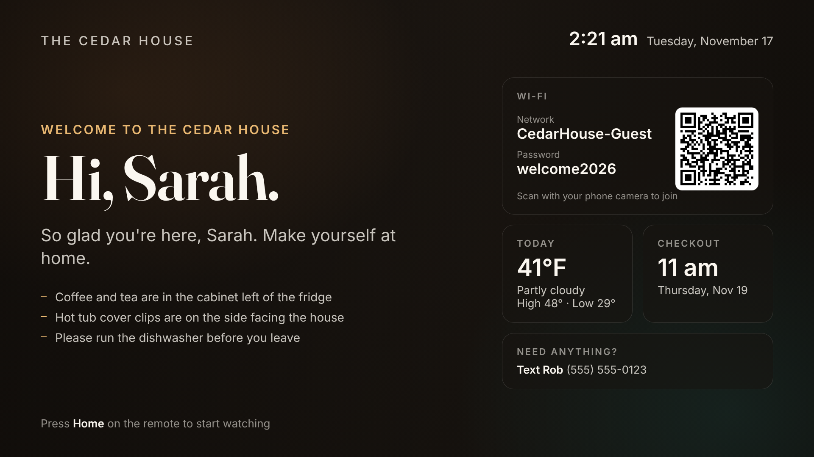

# Airbnb Welcome TV

A personalized welcome screen on each Samsung TV, installed as a real app on the TV (no streaming sticks).
When a guest first unlocks the door, SmartThings turns all 3 TVs on and opens it.



**How it fits together**

```
 Airbnb calendar link ────────► Welcome server ◄── you, on the admin page (add guest names)
   (dates, every 30 min)        (Raspberry Pi or any        │
                                 always-on computer)        │ "door unlocked"
                                    │        ▲              │
                     guest name,    │        └── watches ── SmartThings lock
                     Wi-Fi, notes   ▼
                    3 × Samsung TV app  ◄── SmartThings: power on + open the app
```

* **`server/`**: a small Python program (standard library only, nothing to install). It works out who the current guest is, serves the data to the TVs, runs the admin page, and talks to SmartThings.
* **`web/`**: the welcome screen. The same files run in the TV app and in any browser, for previewing.
* **`tizen/`** + **`build_tizen.sh`**: packages the screen as a Samsung TV app (app ID `WlcmScrn01.Welcome`).

What each TV shows: "Hi, Sarah." plus a message specific to that room, house notes, Wi-Fi name, password and a scan-to-join QR code, today's weather, checkout time and date, and your contact. With no guest checked in, it shows a generic welcome. The page refreshes every minute. If the server is unreachable, it shows the last saved screen.

---

## 1. Set up the server (about 15 minutes)

You need one always-on computer **on the Airbnb's network**. A Raspberry Pi is ideal. An old laptop or a NAS that runs Python also works.

1. Copy this folder to it, e.g. `/home/pi/airbnb-welcome-tv`.
2. In your router, give that computer a fixed IP address (a "DHCP reservation"), e.g. `192.168.1.50`. The TVs are built pointing at this address.
3. Create your settings:

   ```bash
   cd ~/airbnb-welcome-tv/server
   cp config.example.json config.json
   nano config.json
   ```

   Fill in the property name, Wi-Fi, timezone, latitude and longitude (for weather), checkout time, house notes, and an `admin_password`.
   Under `tvs`, name your 3 TVs and write each one's message. `{first_name}` is replaced with the guest's first name.
4. Start it:

   ```bash
   python3 welcome_server.py
   ```

   Open `http://192.168.1.50:8080/admin` on your phone (username: anything, password: your `admin_password`). Add a test stay that includes today's date, then tap **Preview screen**.
5. Make it start on boot:

   ```bash
   sudo cp welcome-tv.service /etc/systemd/system/
   sudo systemctl enable --now welcome-tv
   ```

> Keep the server on the local network only, and don't port-forward it to the internet. The welcome data includes the Wi-Fi password, which is fine on the house network but shouldn't be public.

## 2. Bookings and guest names

The server copies your bookings from Airbnb's calendar link every 30 minutes. That link has each stay's dates and confirmation code but **not the guest's name**, so you add the name yourself. It takes about 10 seconds per booking.

**Connect your Airbnb calendar (once)**

1. On airbnb.com, go to **Calendar** → pick the listing → **Availability** → **Connect calendars** (or **Sync calendars**) → **Export calendar**. Copy the link. It ends in `.ics`.
2. Paste it into `config.json` as `airbnb_calendar.url`, then restart the service.
   To test it right away, run `python3 welcome_server.py sync-airbnb`.

**For each new booking:** it appears on the admin page as **Reserved – add name**, with a **See booking on Airbnb** link and the last 4 digits of the guest's phone. Tap the link to see who it is, tap **Add name** and type it in. You can also set a display name like "Sarah & Mike" and change any TV's message for that stay.

* **If you forget to add a name**, the TVs still come on and show a friendly welcome without one, with the right checkout date.
* **Date changes and cancellations** come through automatically. If a future booking disappears from Airbnb's calendar, it's removed here too. Names you've added are never overwritten.
* **Stays booked outside Airbnb** (friends, family, direct bookings) can be added by hand with the **Add a stay** form.
* **Deleting an Airbnb booking** on the admin page only lasts until the next sync, which brings it back. To change who's welcomed, edit the stay instead.

The calendar link works like a password: anyone with it can see your booking dates, so don't share it.

## 3. Install the app on each TV (about 1 hour the first time)

You do this from a Windows, Mac or Linux computer, once per TV.

**One-time tools**

1. Install **Tizen Studio** (with CLI) from <https://developer.samsung.com/smarttv/develop/getting-started/setting-up-sdk/installing-tv-sdk.html>.
2. In Tizen Studio's **Package Manager**, under *Extension SDK*, install **TV Extensions** and **Samsung Certificate Extension**.
3. Add Tizen's tools to your PATH: `~/tizen-studio/tools` and `~/tizen-studio/tools/ide/bin`.

**On each TV: turn on Developer Mode**

1. Open **Apps** on the TV, then press **1 2 3 4 5** on the remote. On remotes without number keys, use the on-screen number pad.
2. Switch Developer Mode **On**, enter your computer's IP address, and restart the TV. To fully restart it, hold the power button until the logo appears.
3. Note the TV's IP address (Settings → General → Network → Network Status → IP Settings). Give each TV a DHCP reservation too.

**Create a Samsung certificate (once, covering all 3 TVs)**

1. Tizen Studio → **Tools → Device Manager** → add each TV by IP and connect.
2. **Tools → Certificate Manager** → **+** → **Samsung** → **TV** → name the profile, e.g. `Airbnb` → sign in with a Samsung account → privilege level **Public**.
3. When it asks for device IDs (DUIDs), the connected TVs are listed. Include **all 3**. Any TV not on the certificate refuses the app.

**Build and install**

```bash
./build_tizen.sh http://192.168.1.50:8080 Airbnb 192.168.1.61 192.168.1.62 192.168.1.63
```

(server address, certificate profile name, then the 3 TV IPs.) This packages `build/Welcome.wgt` and installs it on each TV.

**First run on each TV:** open **Welcome** from Apps. It asks *"Which TV is this?"*. Pick the room with the arrows and press OK, and the TV remembers it. Press the **red** button any time to change it.

Back exits the app, and Home goes to the normal TV home screen.

## 4. SmartThings: turn on and open the app when the guest arrives

**On each TV:** turn on **Power On with Mobile**. It's under Settings → General → Network → Expert Settings on most models, or Settings → All Settings → Connection on newer ones. Without it, "turn on" fails when the TV is in standby.

**Give the server SmartThings access.** SmartThings personal access tokens now expire after 24 hours, so use the server's built-in OAuth instead. You do this once, and it then refreshes itself.

1. Install the SmartThings CLI (<https://github.com/SmartThingsCommunity/smartthings-cli>), then run `smartthings apps:create`.
   Choose **OAuth-In App**, give it any name, select the scopes **`r:devices:*`** and **`x:devices:*`**, and set the redirect URI to `https://httpbin.org/get`.
   It prints an **OAuth Client Id** and **Client Secret**. Save them, because the secret is shown only once.
2. Put them in `config.json` under `smartthings.client_id` and `client_secret`.
3. Run:

   ```bash
   python3 welcome_server.py smartthings-auth
   ```

   Open the link it prints, approve, and copy the `code` value from the page you land on. It then lists all your SmartThings devices with their IDs.
4. Copy each TV's ID into `tvs.<room>.smartthings_device_id`, and your door lock's ID into `smartthings.lock_device_id`. Restart the service.
5. Test it: on the admin page, tap **Turn on TVs and show welcome**, or run `python3 welcome_server.py launch`.

The server checks the lock every 15 seconds. The first time the door goes from locked to unlocked during a stay, it turns all 3 TVs on and opens Welcome. It does this only **once per stay**, so the TVs don't jump on every time the guests come back from dinner. If there's no current guest (e.g. cleaners), it does nothing.
Set `launch_on_unlock` to `"every_time"` or `"off"` to change that.

> To try it before the OAuth setup, put a personal access token from <https://account.smartthings.com/tokens> in `smartthings.token` (scopes: devices read and execute). It stops working after 24 hours.

## Things to know

* **Re-installing:** apps installed through Developer Mode depend on your Samsung certificate. Expect to rerun `build_tizen.sh` occasionally, e.g. after a big TV firmware update or when the certificate expires. Your guest data and settings live on the server, so nothing is lost.
* **Changing the look or text** doesn't need a reinstall: text, notes, messages and Wi-Fi all come from `config.json` and the admin page. Only changes to files in `web/` need the app rebuilt.
* **Background photo:** set `property.background` (or `tvs.<room>.background` for a different one per room) to an image URL, e.g. `http://192.168.1.50:8080/photos/lake.jpg` after putting `lake.jpg` in `web/photos/`.
* **Different accent color per room:** `tvs.<room>.accent`, e.g. `"#8fc1b5"`.
* **Weather** comes from Open-Meteo (free, no key).
